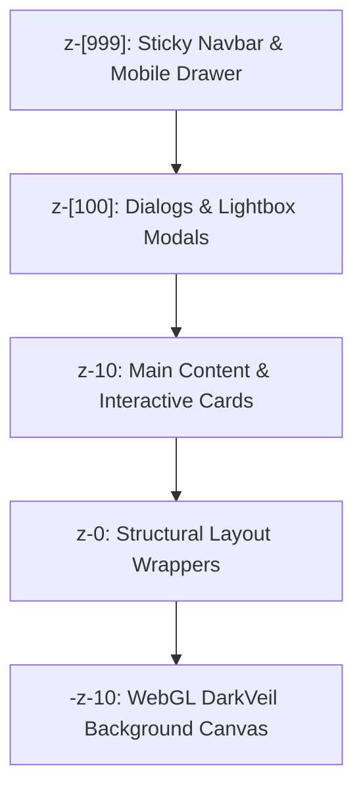

# Design System & UI/UX Specification

This document defines the visual language, design tokens, component architecture, layout guidelines, and accessibility standards for **Mayank Jain's Developer Portfolio**.

---

## 1. Design Philosophy & Visual Language

### Core Aesthetics
- **Dark-First Immersion**: Deep obsidian background with subtle dynamic WebGL noise displacement, minimizing eye strain while conveying a modern engineering focus.
- **Glassmorphism & Depth**: Multi-layered frosted glass surfaces (`backdrop-blur-3xl`, translucent borders, and soft inner rings) creating clear visual hierarchy and physical tactile depth without skeuomorphic clutter.
- **Vibrant Accent Glows**: Electric violet-to-indigo and cyan gradients applied intentionally to hero headers, primary interactive triggers, and key technical highlights.
- **Tactile Feedback & Motion**: Smooth kinetic scrolling powered by Lenis, particle physics typography (`FuzzyText`), and responsive hover/press states (`hover:scale-105`, active depress).

---

## 2. Color System & Design Tokens

The application leverages the **OKLCH** color model for perceptual uniformity, wide-gamut displays, and consistent contrast ratios.

### Color Tokens (Dark Theme Canonical)

| Token | OKLCH / CSS Value | Tailwind Utility Equivalent | Purpose |
| :--- | :--- | :--- | :--- |
| **Canvas Background** | `oklch(0.141 0.005 285.823)` | `bg-neutral-950` / `bg-background` | Base application viewport canvas |
| **Surface (Card)** | `oklch(0.21 0.006 285.885)` | `bg-white/[0.03]` / `bg-neutral-900/40` | Glass card layers and panels |
| **Surface (Muted)** | `oklch(0.274 0.006 286.033)` | `bg-white/5` | Secondary chips, badges, and code tags |
| **Primary Accent** | `oklch(0.92 0.004 286.32)` | `text-violet-400` / `bg-violet-600` | CTAs, active links, primary buttons |
| **Secondary Accent**| `oklch(0.488 0.243 264.376)` | `text-indigo-300` / `bg-indigo-600` | Sub-headings, gradient mid-tones |
| **Highlight / Cyan**| `oklch(0.696 0.17 162.48)` | `text-cyan-400` | Gradient highlight endpoints |
| **Status / Live**   | `oklch(0.72 0.22 142)` | `text-emerald-400` / `bg-emerald-400` | Availability badge, pulse indicators |
| **Border Translucent** | `oklch(1 0 0 / 10%)` | `border-white/10` to `border-white/20` | Frosted glass card boundaries |
| **Foreground Text** | `oklch(0.985 0 0)` | `text-white` (High Contrast) | Headings, titles, primary labels |
| **Muted Text**      | `oklch(0.705 0.015 286.067)` | `text-white/70` (WCAG AA Compliant) | Paragraph copy, descriptions, metadata |

### Gradient Specifications
```css
/* Hero Gradient Text */
background-image: linear-gradient(to right, #a78bfa, #a5b4fc, #22d3ee);

/* Interactive Primary Button */
background-color: #6d28d9; /* violet-700 */
border: 1px solid rgba(167, 139, 250, 0.4);
box-shadow: 0 10px 25px -5px rgba(109, 40, 217, 0.3);
```

### Contrast & Accessibility (WCAG 2.2 AA)
- **Normal Text (< 18pt / 24px)**: Minimum contrast ratio of **4.5:1** against the dark canvas (satisfied by `text-white/80` or brighter).
- **Large Text (>= 18pt / 24px or bold >= 14pt)**: Minimum contrast ratio of **3:1** against the dark canvas (satisfied by `text-white/70` and gradient text).
- **Interactive UI Components & Focus Rings**: Minimum contrast of **3:1** (`ring-violet-400`, `ring-2`).

---

## 3. Typography System

### Typeface Specification
- **Family**: `Inter`, configured via Next.js Google Font (`next/font/google`) with `display: swap` and `subsets: ['latin']`.
- **System Fallback Stack**: `-apple-system, BlinkMacSystemFont, "Segoe UI", Roboto, Helvetica, Arial, sans-serif`.

### Typographic Hierarchy & Scale

| Level | Size (Mobile ➔ Desktop) | Weight | Tracking | Native Text Wrap |
| :--- | :--- | :--- | :--- | :--- |
| **Display / Hero H1** | `32px (2rem)` ➔ `60px (3.75rem)` | 800 (Extrabold) | `-0.025em` (tight) | `text-wrap: balance` |
| **Section Title H2**  | `24px (1.5rem)` ➔ `36px (2.25rem)` | 700 (Bold) | `-0.02em` | `text-wrap: balance` |
| **Card / Project H3** | `18px (1.125rem)` ➔ `24px (1.5rem)` | 600 (Semibold) | `-0.01em` | `text-wrap: balance` |
| **Body Large**        | `16px (1rem)` ➔ `18px (1.125rem)` | 400 (Regular) | `normal` | `text-wrap: pretty` |
| **Body Standard**     | `14px (0.875rem)` ➔ `16px (1rem)` | 400 (Regular) | `normal` | `text-wrap: pretty` |
| **Caption / Badges**  | `11px` ➔ `12px (0.75rem)` | 600 (Semibold) | `0.05em` (wide) | `nowrap` |

---

## 4. Layout, Spacing & Breakpoints

### Responsive Breakpoints

| Breakpoint | Minimum Width | Target Devices | Layout Behavior |
| :--- | :--- | :--- | :--- |
| **Mobile (`default`)** | `< 640px` | Phones (iPhone, Pixel) | Single-column grids, flat scroll stack, 44px tap targets |
| **Tablet (`sm` / `md`)**| `640px - 1024px` | iPads, Small Tablets | 2-column grids, expanding drawers, stacked detail cards |
| **Desktop (`lg` / `xl`)**| `> 1024px` | Laptops & Desktops | Full 3-column grids, 3D sticky scroll deck, fixed header |

### Grid Containers
- **Standard Section Width**: `max-w-5xl` (1024px) with `px-4 sm:px-6 md:px-8`.
- **Navigation & Wide Views**: `max-w-6xl` (1152px) with fluid padding.
- **Vertical Spacing Scale**: Section gaps use `py-16 md:py-24` (`4rem` to `6rem`) ensuring breathing room between distinct modules.

### Modern Viewport Units
- Replaced standard `100vh` with dynamic viewport units **`h-dvh`** across canvas backgrounds (`DarkVeil`) and full-bleed overlays to prevent mobile address bar jumping during scroll events.

---

## 5. Surface & Glassmorphism Specification

### The `.glass` Utility Pattern
Defined in `src/app/globals.css`:
```css
.glass {
  backdrop-filter: blur(24px) saturate(180%);
  -webkit-backdrop-filter: blur(24px) saturate(180%);
  background-color: rgba(0, 0, 0, 0.2);
  border: 1px solid rgba(255, 255, 255, 0.15);
  box-shadow: 0 8px 32px 0 rgba(0, 0, 0, 0.37);
}
```

### Elevation & Z-Index Stack


---

## 6. Core Component Architecture

### 1. Navigation Bar (`Navbar.jsx`)
- **Sticky Blur**: Transitions from transparent to `bg-black/40 backdrop-blur-2xl border-white/15` after 20px scroll offset.
- **Brand Title**: Interactive particle canvas rendering `Mayank.dev` with an accessible `sr-only` fallback text for screen readers.
- **Mobile Menu**: Full drawer rendered with `bg-neutral-950/95 backdrop-blur-2xl border-b border-white/15`, preventing background text bleeding.
- **Tap Targets**: All hamburger and link triggers measure at least `44×44px`.

### 2. Profile & Hero Card (`page.js`)
- **Radial Glow**: Ambient pseudo-element blur (`bg-violet-600/15 rounded-full blur-3xl`).
- **Availability Pill**: Pulse animation on status beacon (`bg-emerald-400 animate-pulse`).
- **Dual CTAs**: High-emphasis solid violet action button alongside a secondary frosted glass button with leading icon.

### 3. Interactive Social Dock (`GlassSocialIcons.jsx`)
- **CSS Variable Injection**: Individual platform brand colors injected via `--hover-color` to eliminate runtime stylesheet pollution.
- **Tactile Transitions**: `hover:-translate-y-1 hover:scale-105` with subtle box-shadow glow matching the brand tone.
- **Keyboard Access**: High-contrast outline with `focus-visible:ring-2 focus-visible:ring-violet-400`.

### 4. Project Showcase Deck (`ScrollStack.jsx` & `Projects.jsx`)
- **Desktop Dynamic Deck**: Sticky-scroll 3D transform that stacks cards with scale decay (`baseScale: 0.85`, `itemScale: 0.03`) and vertical offset.
- **Mobile Degradation**: On viewports `< 768px`, 3D scale transforms and sticky stacking are gracefully replaced with natural vertical flow to prevent card clipping and vertical text squishing.
- **Fluid Sizing**: Minimum height set to `min-h-[22rem] h-auto` with responsive padding `px-4 sm:px-8 md:px-12`.

### 5. Technical Skill Marquee (`LogoLoop.jsx`)
- **Continuous Velocity**: Seamless marquee of technical skills and toolchains.
- **Interactive Control**: Automatically pauses animation on hover or keyboard focus.
- **Motion Safety**: Respects `prefers-reduced-motion` by converting into a static wrapped grid.

### 6. Dynamic Project Case Studies (`src/app/projects/[projectName]/page.js`)
- **Static Generation**: Implements `generateStaticParams()` for instant SSG load times across all portfolio entries.
- **Dynamic SEO**: Implements `generateMetadata()` providing dedicated OpenGraph images and Twitter summary cards per project.
- **Semantic Structure**: All feature lists enclosed in semantic `<ul>` and `<li>` elements.
- **Optimized Imagery**: Implements `next/image` with responsive `sizes` attribute and `priority` flag on primary screenshots to protect Largest Contentful Paint (LCP).

---

## 7. Motion & Shader Guidelines

### 1. WebGL Background Shader (`DarkVeil.jsx`)
- **Engine**: Lightweight OGL WebGL renderer.
- **Displacement**: Organic noise math creating slow-moving ethereal light veils.
- **Performance Safeguards**:
  - Automatically suspends render loop when tab is hidden (`document.visibilityState === "hidden"`).
  - Explicit WebGL context loss handling on component unmount.
  - Skips animation loop entirely when `prefers-reduced-motion: reduce` is enabled.

### 2. Particle Typography (`FuzzyText.jsx`)
- **Physics**: Real-time particle flocking simulation responding to cursor hover radius.
- **Optimization**: Rasterizes text offscreen once, reading pixel data to seed particle coordinates without synchronous layout thrashing.
- **Screen Reader Support**: Hidden canvas with semantic text fallback.

---

## 8. Web Standards & Baseline Target

Per project governance, all styling and browser features conform to **Baseline Newly Available**:

| Feature | Implementation | Browser Support |
| :--- | :--- | :--- |
| **OKLCH Color Function** | `globals.css` color system | Widely supported in all modern evergreen browsers |
| **Dynamic Viewport (`dvh`)**| `h-dvh` in canvas & full-screen layouts | Baseline 2023+ (iOS Safari 15.4, Chrome 108, Firefox 101) |
| **`text-wrap: balance`** | All `h1`, `h2`, `h3` heading elements | Baseline 2023+ (Chrome 114, Safari 17.5, Firefox 121) |
| **`text-wrap: pretty`**  | Paragraph copy (`p`) for orphan prevention | Baseline 2024+ (Chrome 117, Safari 18, Firefox 123) |
| **Backdrop Filter**      | Glassmorphism blur styling | Universally supported across modern browsers |

---

## 9. Design Checklist for Future Additions

When adding new components, pages, or sections to the portfolio:
1. **Glass Token Usage**: Use `.glass` or `bg-white/5 border border-white/10 backdrop-blur-xl` for any new cards.
2. **Accessible Tap Targets**: Ensure every interactive button, tab, or link has a minimum clickable footprint of `44×44px`.
3. **Contrast Verification**: Ensure text uses `text-white` for titles, `text-white/80` for body, and `text-white/70` for metadata. Avoid opacity below `60%` for text.
4. **Motion Fallbacks**: Wrap GSAP/Framer animations with `window.matchMedia("(prefers-reduced-motion: reduce)")` checks.
5. **No Nested Interactives**: Never place `<button>` or `<a>` elements inside another `<Link>` or `<button>`.
